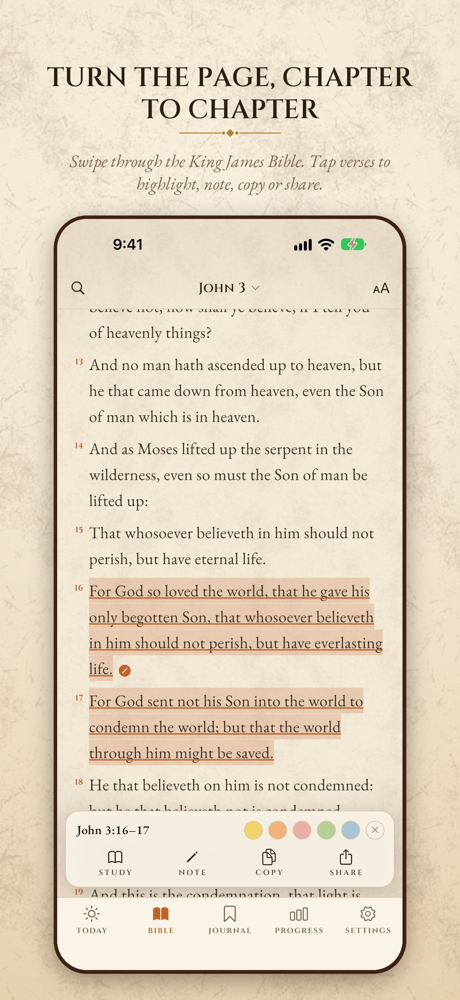
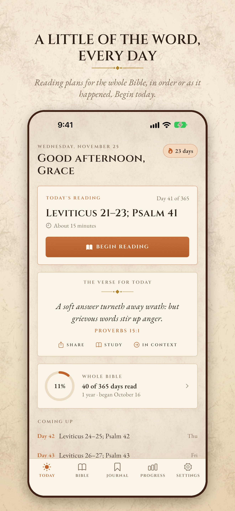
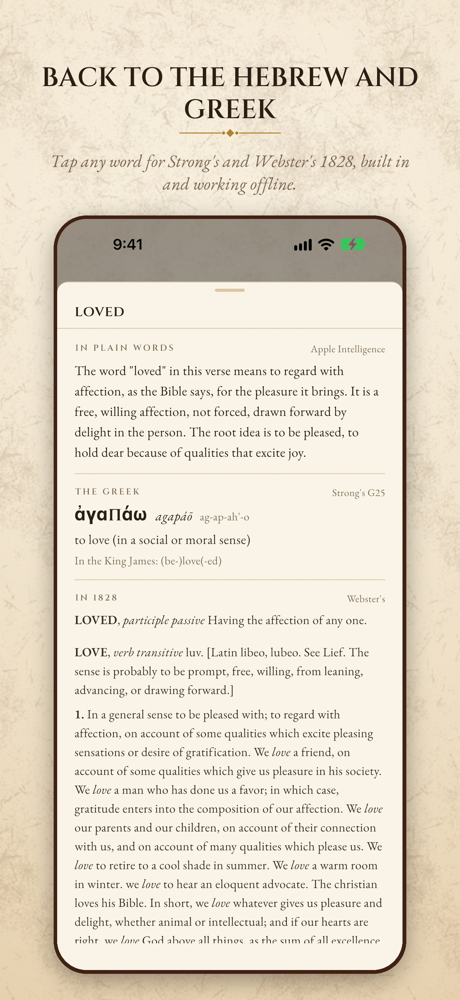
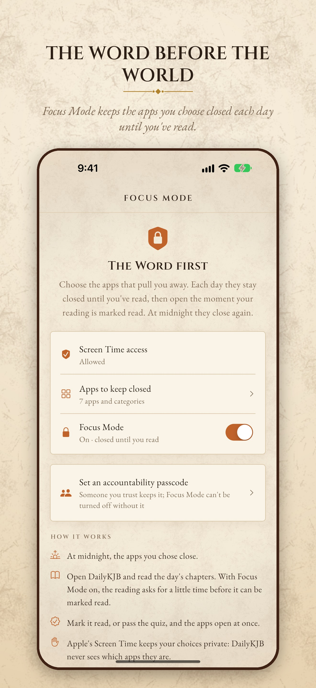
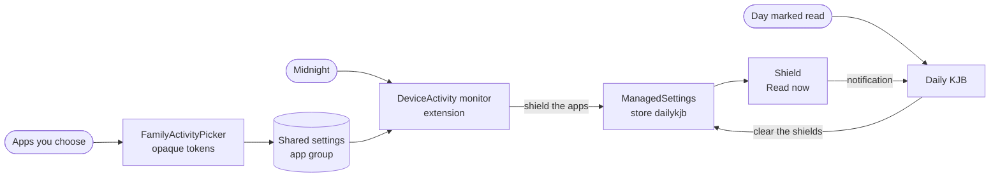

<div align="center">


# Daily KJB

**The King James Bible, a little every day, and help understanding what you read.**

Free on iPhone and iPad. Everything works offline: no account, no cloud, no tracking.

</div>

<p align="center">
  
</p>

<table align="center">
  <tr>
    <td></td>
    <td></td>
    <td></td>
  </tr>
  <tr>
    <td align="center">Today</td>
    <td align="center">Word study</td>
    <td align="center">Focus Mode</td>
  </tr>
</table>

## What it does

- **A plan for every reader.** The whole Bible in order or as it happened, the Old Testament, or the New a passage a day, over 3 months to 2 years. Add a Psalm or Proverb each day. Fall behind and pick up from today; nothing read is lost.
- **A Bible you turn like a book.** A chapter to a page, swiped with a tap of haptics. A verse to a line or as a paragraph, in Garamond, Georgia or a clean type, at any size. Tap verses to highlight, note, copy, or share as a picture.
- **Every word back to the Hebrew and Greek.** Tap a word for Strong's and for Webster's 1828 together, plus cross references for every verse. Built in, so it works with no connection.
- **Study help from Apple Intelligence.** Notes on a verse, a word's meaning in plain English, and a quiz on the day's reading, written on the device. References the model gives are checked against the Bible before they're shown. Phones without Apple Intelligence keep every other study tool.
- **Focus Mode.** Apps you choose stay closed each day until you've read, then open the moment the day is marked read. They close again at midnight, whether or not the app is opened. An accountability partner can hold a passcode.
- **Parchment by day, lamplight by night.** Light, dark, or follow the phone.

## How Focus Mode works



The app asks for Screen Time access for the device's own user (`.individual`). The chosen apps are tokens iOS keeps private; the app can't tell which apps they are. A repeating `DeviceActivity` schedule from midnight to midnight wakes the monitor extension at the start of each day to raise the shields; marking the day read clears them until the next midnight. A shield can't open another app, so its **Read now** button posts a local notification that does.

## Study, offline

Each verse's words carry the Strong's numbers behind them. The app lines them up with the words of the King James text (99.8% across the Bible) so a tap on "loved" in John 3:16 finds G25 *agapaō*, and looks up "loved" in Webster's 1828, trying the forms the King James uses (*goeth*, *saith*, *believeth*) when the word isn't there as spelled. The data is split by book and by letter, so a lookup opens one small file.

## Build from source

Requirements: macOS with Xcode 26 or later and Flutter 3.50 or later (Dart 3.14). Apple Intelligence features need iOS 26 or later on a device that has it; everything else runs on iOS 16 and later.

```bash
git clone https://github.com/Cinderwire-co/DailyKJB.git
cd DailyKJB/dailykjb
flutter pub get
flutter test
flutter run --release        # on a connected iPhone
```

To install on your own device, copy `dailykjb/ios/Flutter/Signing.xcconfig.example` to `Signing.xcconfig` in the same folder and put your Apple Developer Team ID in it. That file is git-ignored, so your team ID never ends up in a commit. Focus Mode needs the Family Controls capability on your own App IDs (development builds work as soon as it's enabled).

App Store screenshots are generated, not hand-made: `tools/screenshots.sh` launches the simulator into staged screens with demo data, and `tools/frame_screenshots.py` adds captions. The icon and the paper grain are drawn by `tools/make_icon.py` and `tools/make_grain.py`. The image scripts need Pillow and numpy:

```bash
python3 -m venv tools/.venv && tools/.venv/bin/pip install pillow numpy
tools/.venv/bin/python tools/make_icon.py
```

The Bible text and study data are built by `tools/prepare_study_data.py` from the sources listed in [NOTICE.md](NOTICE.md).

## Project layout

```
dailykjb/lib/
  bible/            the King James text, plan passages, Strong's, Webster's 1828, cross references
  screens/          Today, the Bible, the day's reading, study, journal, progress, settings, Focus Mode
  services/         plans, highlights and notes, reminders, Apple Intelligence, Screen Time bridge
  ui/               the parchment theme and shared widgets
dailykjb/ios/Runner/                   Screen Time manager and the Apple Intelligence bridge
dailykjb/ios/DeviceActivityMonitorExtension/, ShieldConfiguration/, ShieldAction/
dailykjb/android/                      Focus Mode on Android (usage access and an overlay)
store/              App Store listing and screenshots
tools/              data, screenshot, icon and upload scripts
```

More detail in [docs/ARCHITECTURE.md](docs/ARCHITECTURE.md).

## Privacy

Nothing leaves the device. Reading progress, notes, highlights and settings are stored only on the device; Apple Intelligence runs on the device; Focus Mode's choices are tokens the app can't read. See [PRIVACY.md](PRIVACY.md).

## License

Daily KJB is source-available under the [PolyForm Noncommercial License 1.0.0](LICENSE.md). You can use, study, change and share it for any noncommercial purpose, including religious observance and use by churches and other charities. You may not sell it or use it commercially. For other licensing, open an issue.

The Bible text, Strong's, Webster's 1828, the cross references and the fonts are third-party material under their own terms; see [NOTICE.md](NOTICE.md).

Contributions are welcome; see [docs/CONTRIBUTING.md](docs/CONTRIBUTING.md).
